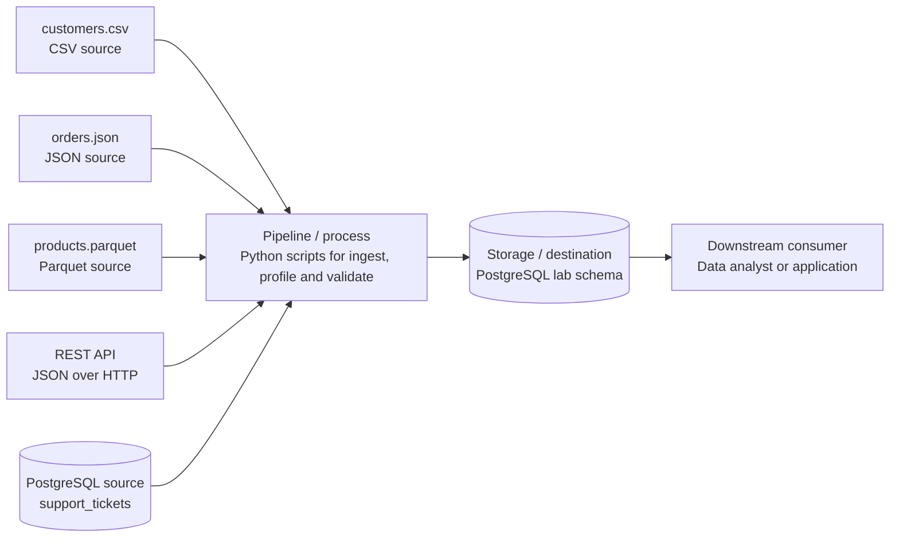

# Data Engineering Lifecycle Map

## Lifecycle Table

| Lifecycle Element | What It Means | Example in This Lab | Primary Tool/Artifact | Possible Failure |
|---|---|---|---|---|
| Source system | The place where data originates, outside the pipeline. | customers.csv, orders.json, products.parquet, a JSON REST API, and the PostgreSQL support_tickets table. | Files in data/raw/, the API URL, the PostgreSQL container. | A file is missing or renamed, the API is unavailable, or the owner changes columns without notice. |
| Ingestion/acquisition | Reading or retrieving data from a source so it can be used in the workspace. | inspect_api.py requests the API and saves the response to data/raw/api_snapshot.json. pandas reads the three files. | Python, requests, pandas, pyarrow. | A request timeout, a wrong file path, the wrong reader for a format, or an incomplete download. |
| Storage | Where data is kept after it has been acquired. | Raw files in data/raw/ and a PostgreSQL 16 database running in Docker. | File system, PostgreSQL container, dss150p_pgdata volume. | The container is stopped, the port is already in use, the credentials do not match, or the volume is lost. |
| Processing/transformation | Changing raw data into a consistent form that is ready for use. | Parsing dates, standardizing types, and flattening nested JSON. In this lab the sources are only profiled and are not transformed. | pandas, SQL. | Type conversion errors, lost nested fields, or rows dropped without anyone noticing. |
| Data quality/validation | Checking that the data meets stated expectations before it is trusted. | Null and duplicate counts from profiling, the CHECK constraint in 01_create_schema.sql, and the rules in data_contract.yaml. | profile_sources.py, SQL constraints, data contract. | Duplicates or invalid values pass unnoticed because no rule was defined. |
| Delivery | Making prepared data available to the people or systems that need it. | Tables in the lab schema of PostgreSQL and the documents in the repository. | PostgreSQL tables, repository docs. | Stale data is delivered, or the database schema no longer matches the contract. |
| Consumer | The person or system that uses the delivered data. | The analytics team, an analyst running SQL queries, or an application reading from PostgreSQL. | SQL queries, notebooks, dashboards. | The consumer receives wrong or late data and makes a wrong decision. |

## Data Flow Diagram

